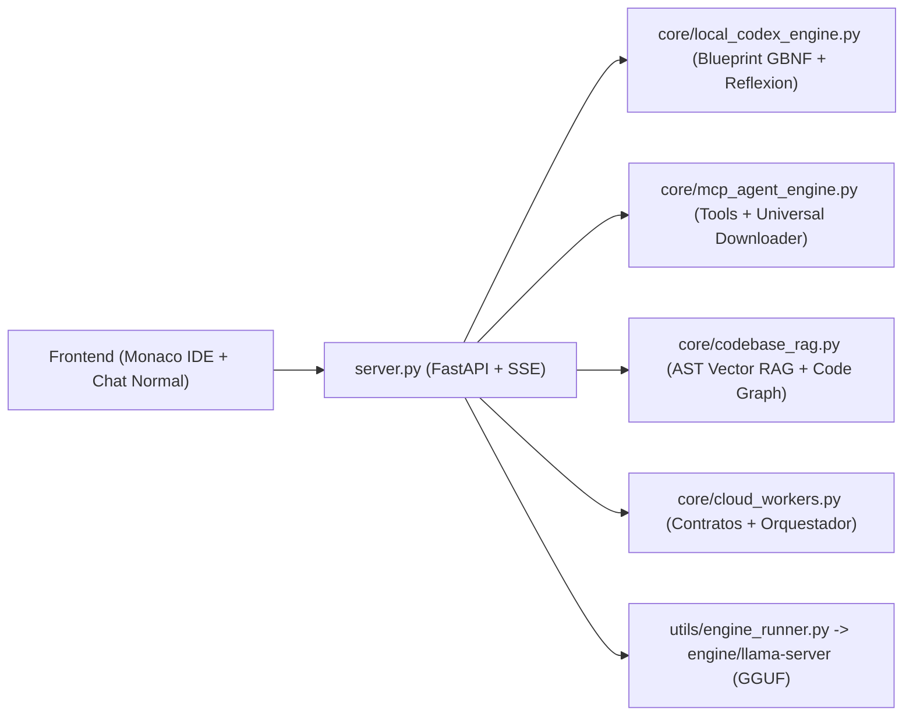

<div align="center">

# LLMAgent

**IDE Agéntico Local con Motor GGUF, Monaco Editor, MCP Tools y Gestor de Modelos estilo LM Studio**

[](https://www.python.org/)
[](https://fastapi.tiangolo.com/)
[](https://github.com/ggml-org/llama.cpp)
[](https://microsoft.github.io/monaco-editor/)

</div>

---

## Características principales

- **Editor IDE completo**: Monaco Editor con pestañas, árbol de archivos, terminal integrada, compilador y vista previa web en vivo.
- **Agente Autónomo (`Crear Apps`)**:
  - Planificación estructurada con gramática **GBNF** (`json_schema`) adaptada al tipo de app (**Single HTML**, **Web Estática**, **Full-Stack** o **Python**).
  - **Codebase Vector RAG** + **Code GraphRAG** + verificación multi-compuerta **Reflexion** (AST, imports, ejecución real, integridad HTML/DOM y `node --check`).
  - **Herramientas MCP** con *Tool Masking* por intención y *Few-Shot* dinámico (`read_file`, `write_file`, `apply_patch`, `search_web`, `download_url`, `compile_project`, etc.).
  - **Descargador universal de archivos públicos**: busca y descarga `.glb`/`.gltf` (Khronos), imágenes (Wikimedia), papers (arXiv), videos/audio/datasets (Internet Archive) y repositorios GitHub directamente a tu proyecto.
- **Chat Normal independiente (`Pregunta Normal`)**: hilo separado con pestañas múltiples, historial persistente en `localStorage` y vista dedicada en pestaña completa (`/static/chat.html`).
- **Gestor de Modelos estilo LM Studio**: cambia entre tus `.gguf` locales en 1 clic, busca y descarga nuevos modelos directamente desde **Hugging Face Hub**, con auto-ajuste dinámico de capas GPU, soporte **MoE** (`-ot`) y **Speculative Decoding** automático (`--model-draft`).
- **Privacidad y modo híbrido**: 100% local en tu GPU/CPU, con toggles opcionales para búsqueda web en vivo, **Proxy / Tor (SOCKS5)** y **Cloud Workers**.

---

## Instalación rápida (3 pasos)

Los binarios pesados de `llama.cpp` (`engine/`) y los modelos `.gguf` (`models/`) se omiten del repositorio para mantenerlo ligero; **`setup.py` descarga todo automáticamente** según tu hardware (GPU NVIDIA CUDA 12.4 o CPU):

```bash
# 1. Clonar el repositorio
git clone https://github.com/TU_USUARIO/LLMAgent.git
cd LLMAgent

# 2. Instalar dependencias, motor llama.cpp y modelo GGUF inicial
python setup.py

# 3. Iniciar la aplicación (abre http://127.0.0.1:7860 automáticamente)
python run.py
```

### Opciones de `setup.py`

| Comando | Descripción |
| :--- | :--- |
| `python setup.py` | Instala `requirements.txt`, detecta GPU/CPU, descarga `llama.cpp` y baja `Qwen 2.5 Coder 7B (4.68 GB)` |
| `python setup.py --model llama-3.2-3b` | Instala con `Llama 3.2 3B (2.02 GB)` — ideal para PCs ligeras |
| `python setup.py --model qwen3-8b` | Instala con `Qwen 3 8B IQ4_XS (4.28 GB)` — cabe 100% en 6 GB VRAM |
| `python setup.py --model qwen2.5-coder-14b` | Instala con `Qwen 2.5 Coder 14B (7.56 GB)` — alta calidad en modo híbrido GPU+RAM |
| `python setup.py --no-model` | Solo instala dependencias y motor; descarga modelos después desde el botón **Modelos** en la UI |
| `python setup.py --cpu` | Fuerza la descarga de binarios CPU (sin CUDA) |

---

## Arquitectura del proyecto



### Estructura de carpetas

```text
LLMAgent/
├── run.py                      # Lanzador principal (http://127.0.0.1:7860)
├── setup.py                    # Instalador 1-clic (pip + llama.cpp + modelo GGUF)
├── server.py                   # Backend FastAPI, SSE, API de workspace y Hub de Modelos
├── requirements.txt            # Dependencias Python
├── Dockerfile                  # Contenedor opcional
├── core/                       # Motores principales del agente
│   ├── cloud_workers.py        # Generadores local/nube y extracción de contratos HTML/CSS/JS/PY
│   ├── codebase_rag.py         # Indexación vectorial AST y Code GraphRAG
│   ├── cybersecurity_kg.py     # Grafo de conocimiento técnico
│   ├── local_codex_engine.py   # Clasificador de arquetipos, GBNF y verificación Reflexion
│   ├── mcp_agent_engine.py     # Herramientas MCP, búsqueda web y descarga en streaming
│   └── terminal_engine.py      # Terminal integrada y auditoría de dependencias
├── utils/                      # Utilidades compartidas
│   ├── engine_runner.py        # Cargador ctypes de llama-server-impl.dll
│   └── net_utils.py            # Descargas SSL-safe con progreso y reanudación
├── scripts/
│   └── download_model.py       # Descargador CLI interactivo de modelos GGUF
├── static/                     # Interfaz web (IDE + Chat Normal + Splash)
├── engine/                     # Binarios de llama.cpp (generado por setup.py)
└── models/                     # Modelos .gguf locales (generado por setup.py o la UI)
```

---

## Requisitos recomendados

- **Python**: 3.10 o superior
- **GPU (recomendado)**: NVIDIA con **6 GB+ VRAM** (CUDA 12.4) — también funciona en **CPU** automáticamente
- **RAM**: 16 GB recomendados (para modelos 7B–8B en GPU o 12B–14B en modo híbrido)
- **Node.js** *(opcional)*: habilita la verificación automática de sintaxis JS (`node --check`) en el bucle Reflexion

---

## Licencia

Uso libre para desarrollo y aprendizaje local.
